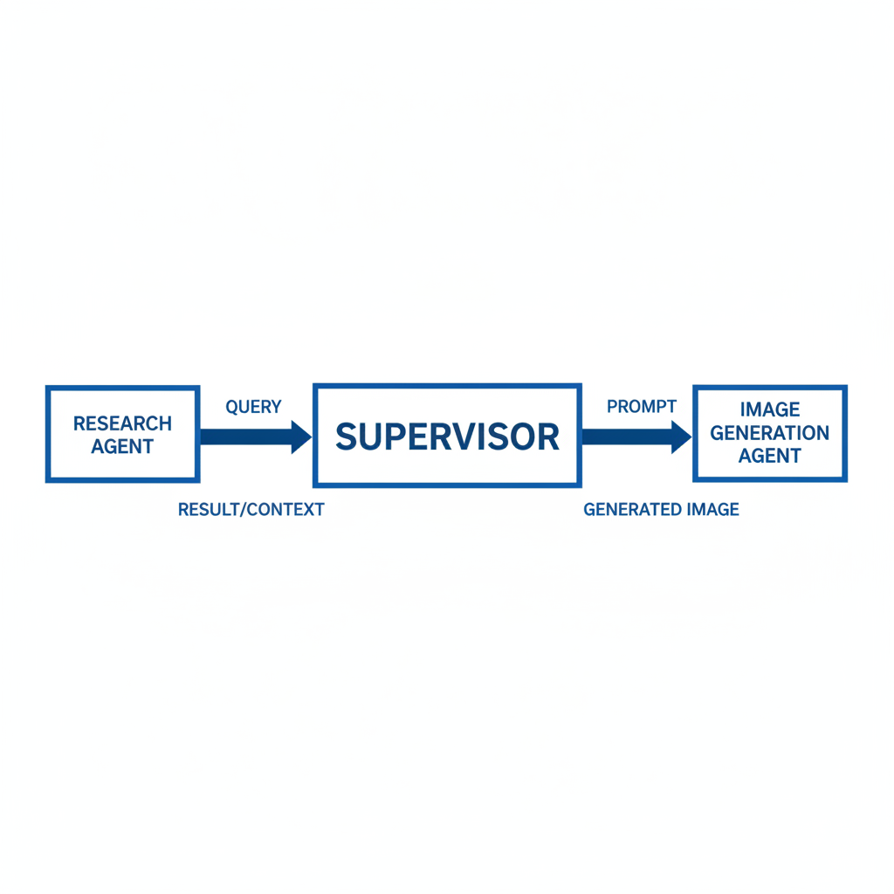
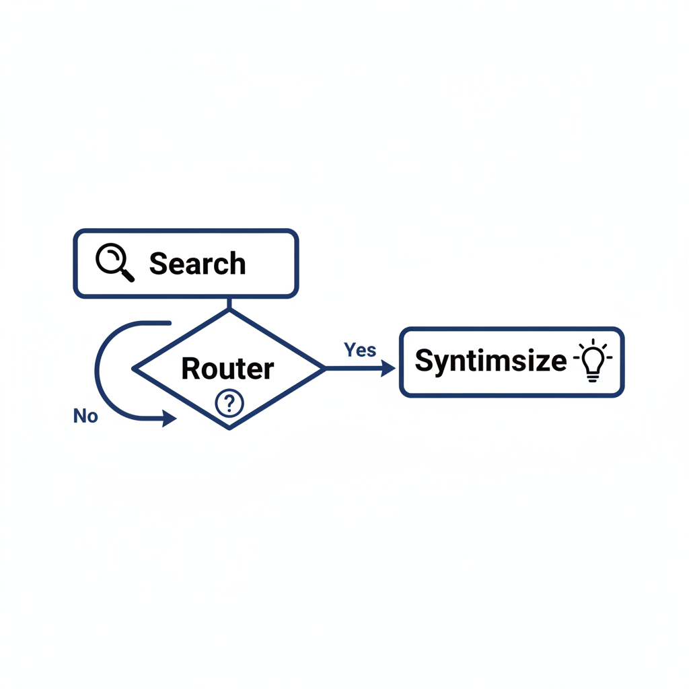
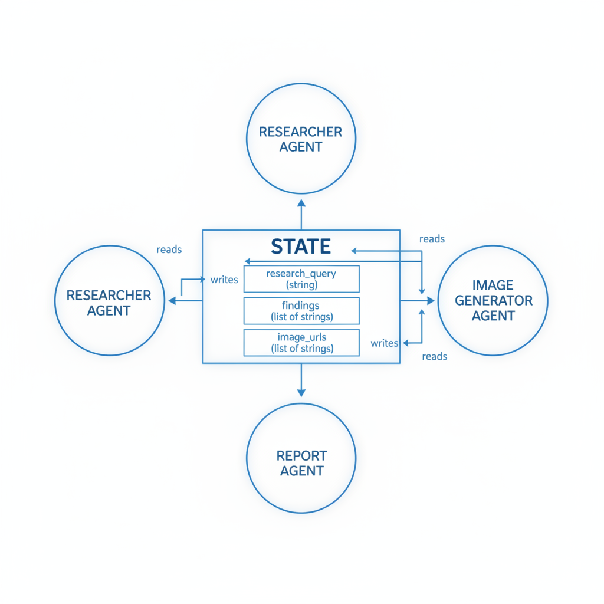
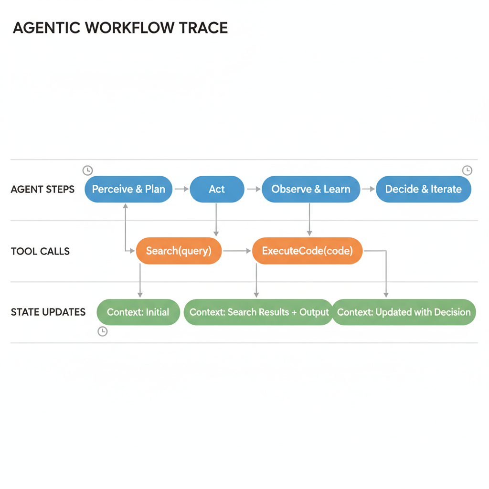

# Orchestrating Research and Creative Agents with LangGraph

## Architecting the Multi-Agent Workflow

To build a robust research-to-generation pipeline, you must define a supervisor node that acts as the central orchestrator. This node evaluates incoming requests and delegates tasks to specialized agents—such as a research agent for data gathering or an image generation agent for visual synthesis. 
*The supervisor node acts as the central orchestrator, delegating tasks based on the user's intent.* By routing logic through a supervisor, you ensure that the system maintains a clear separation of concerns between information retrieval and creative output.

State objects are the backbone of this architecture, serving as a shared memory space that persists across multi-step workflows. By defining a schema for your state, you can track research findings, image prompts, and execution history, ensuring each agent has the necessary context to perform its specific function without redundant processing.

When coordinating these agents, you must choose between swarm and hierarchical architectures. Swarm patterns allow agents to communicate peer-to-peer, which is useful for dynamic, non-linear tasks, whereas hierarchical structures—often managed by a supervisor—provide the strict control required for complex, multi-stage research pipelines.

Finally, LangGraph’s checkpointing mechanism is essential for long-running research tasks. By saving the state at each node transition, you gain the ability to pause, inspect, or resume workflows if an agent encounters an error or requires human-in-the-loop intervention. This persistence ensures that your system remains resilient, allowing you to recover from failures without restarting the entire research process from scratch.

## Implementing the Research Agent

To build a robust research agent, we must move beyond simple prompt-response cycles and implement a stateful, iterative workflow. The first step is integrating a reliable search tool, such as Tavily, into the LangChain ecosystem. By wrapping the search API in a `@tool` decorator, we expose it to the LLM as a structured function call.

```python
from langchain_community.tools.tavily_search import TavilySearchResults
from langchain_core.tools import tool

@tool
def search_tool(query: str):
    """Performs a web search for the given query."""
    try:
        search = TavilySearchResults(max_results=3)
        results = search.invoke(query)
        return results if results else "No relevant information found."
    except Exception as e:
        return f"Search failed: {str(e)}"
```

The agent’s intelligence relies on its ability to perform iterative search and summarization. We configure the LLM to act as a controller that evaluates search results against the user's original intent. If the initial results are insufficient, the agent is prompted to refine its query or broaden its search scope. This loop continues until the agent determines it has gathered enough context to synthesize a final answer.

State management is handled via LangGraph’s `State` object, which acts as the single source of truth for the agent's progress. We define nodes for `searching` and `synthesizing` to maintain a clean separation of concerns. The `searching` node executes the tool and updates the state with raw data, while the `synthesizing` node processes that data into a coherent narrative. 
*The research agent uses a conditional loop to refine queries until sufficient information is gathered.*

Transitions between these states are managed by conditional edges. After the `searching` node completes, a router function inspects the state: if the search results are empty or inconclusive, the graph routes back to the `searching` node for a retry; otherwise, it proceeds to the `synthesizing` node. This graph-based approach ensures that the agent remains resilient to transient network errors or poor search results.

## Integrating Image Generation Tools

To extend your research agent, you must integrate image generation models like DALL-E 3 or Stable Diffusion. Start by wrapping the API in a custom LangChain tool. This allows the agent to invoke generation dynamically based on research findings.

```python
from langchain.tools import tool

@tool
def generate_research_visual(prompt: str):
    """Generates an image based on a detailed research summary."""
    # Implementation for DALL-E 3 or Stable Diffusion API call
    response = client.images.generate(prompt=prompt, n=1, size="1024x1024")
    return response.data[0].url
```

Effective prompt engineering is critical here. Raw research data is often too dense for image models. Use a "Prompt Refiner" node in your LangGraph workflow to distill research summaries into concise, visual-centric descriptions—focusing on style, composition, and subject matter—before passing them to the tool.

State management is essential when handling these assets. Rather than storing heavy binary data directly in the LangGraph state, store the returned URL or a reference to an S3 bucket path. This keeps your state object lightweight and performant, preventing serialization bottlenecks during graph transitions.

## Managing State and Persistence

Reliable agentic workflows require robust state management to track progress across complex research and creative tasks. In LangGraph, we define the graph state using a `TypedDict`, which acts as the single source of truth for our agents. For a research-to-image pipeline, this schema must capture both the research findings and the metadata associated with generated assets. 
*The State object acts as a shared memory, using reducers to append findings and image URLs.*

The use of `Annotated` with `operator.add` implements a reducer, ensuring that when multiple nodes (e.g., a research agent and an image generator) update the state, their contributions are appended rather than overwritten. This pattern is essential for maintaining a clean history of research iterations and generated image references as the graph executes.

To ensure system reliability, we must implement persistence. LangGraph supports checkpointing, which saves the state of the graph at every step. By configuring a `SqliteSaver` or `PostgresSaver`, you create a durable record of the agent's execution path. This is critical for long-running processes where network latency or API failures might otherwise result in lost progress.

## Observability and Debugging

Managing complex multi-agent workflows requires deep visibility into how state evolves and how tools interact. To effectively monitor agent performance, integrate LangSmith to trace reasoning chains and tool execution paths. By capturing every step of the graph, you can visualize the decision-making process, which is critical when debugging non-deterministic research agents. 
*LangSmith provides visibility into the reasoning chain and tool execution paths for debugging.*

Beyond tracing, implement structured logging for node transitions. Tracking the entry and exit points of your research pipeline allows you to identify latency bottlenecks or circular logic loops that often plague autonomous systems. Use these logs to correlate specific state updates with performance degradation, ensuring your graph remains performant as it scales.

Finally, verify agent outputs using human-in-the-loop (HITL) approval steps. Before the graph triggers a final image generation tool, implement a breakpoint in the LangGraph workflow. This allows a human operator to inspect the research summary and approve the prompt before the agent consumes expensive compute resources or generates inaccurate visual content.
